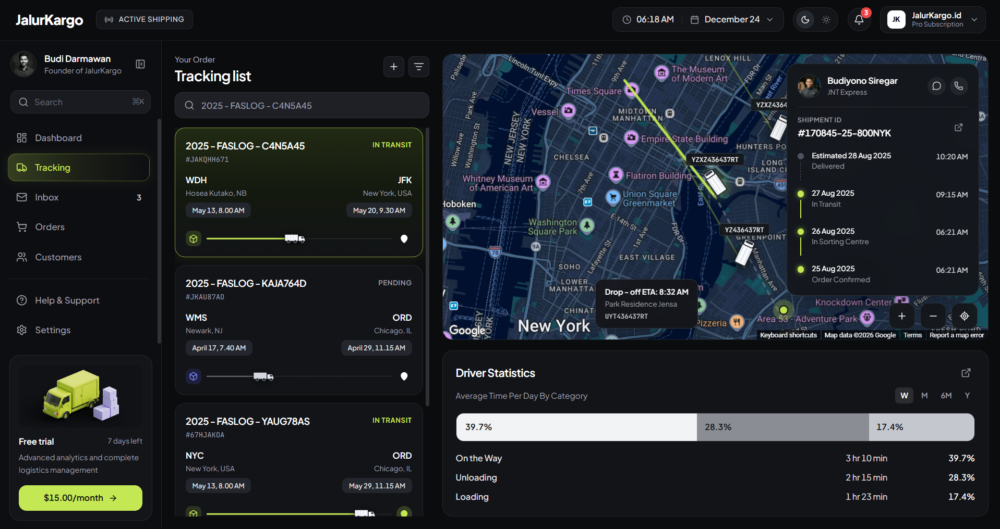
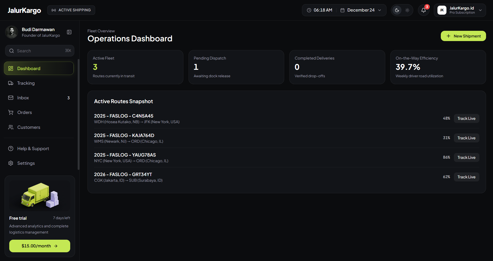
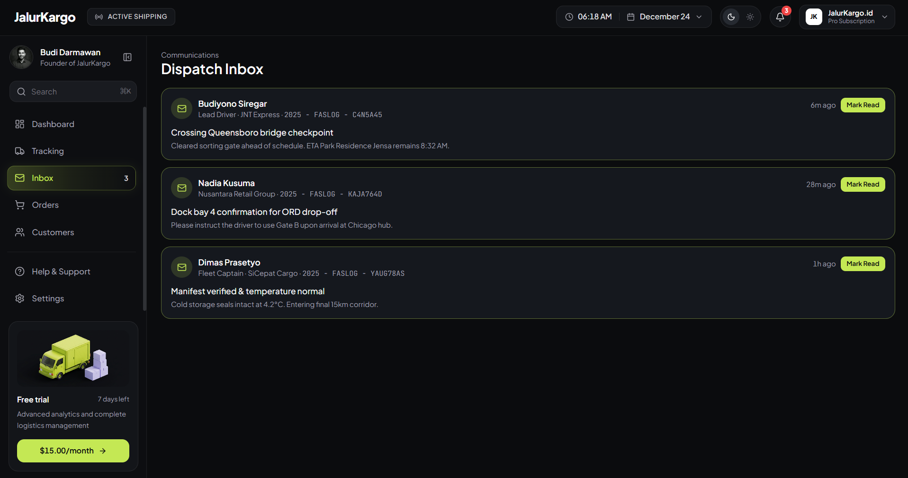
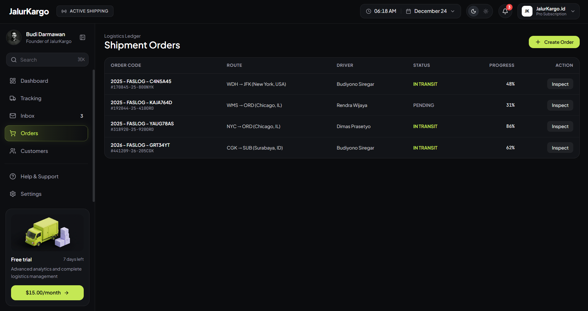
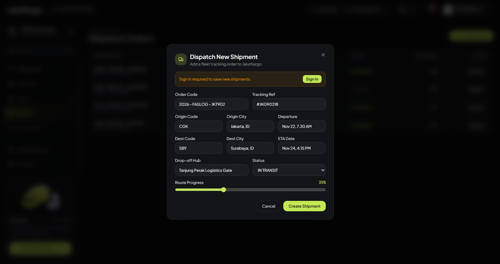
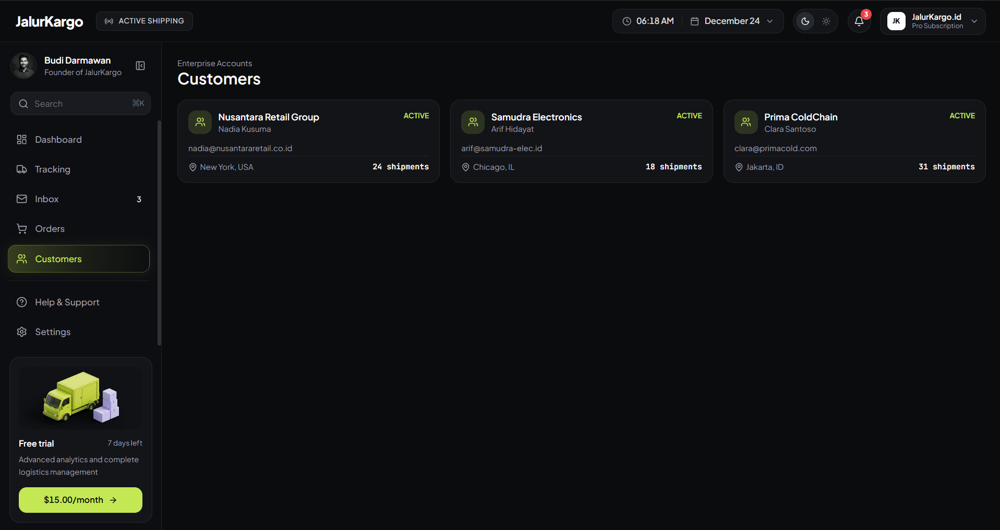

<div align="center">

# JalurKargo

**Real-Time Fleet Management & Live Shipment Telemetry SaaS Platform**

Modern dark-mode logistics command center powered by Google Maps, Socket.IO real-time telemetry streaming, separated User & Machine-to-Machine Ingest authentication, and PostgreSQL + Drizzle ORM.

<p>
  
  
  
  
  
  
  
  
</p>

</div>

---

## Interface Showcase

### Live Fleet Tracking & Route Telemetry
<p align="center">
  
</p>

### Operations Suite (3 × 2 Workspace Grid)

<table>
  <tr>
    <td width="33.3%" align="center">
      
      <br />
      <sub><strong>Operations Dashboard</strong> — Fleet KPI & route snapshot</sub>
    </td>
    <td width="33.3%" align="center">
      
      <br />
      <sub><strong>Dispatch Inbox</strong> — Real-time driver & hub alerts</sub>
    </td>
    <td width="33.3%" align="center">
      
      <br />
      <sub><strong>Shipment Orders</strong> — Full logistics status ledger</sub>
    </td>
  </tr>
  <tr>
    <td width="33.3%" align="center">
      
      <br />
      <sub><strong>New Shipment Modal</strong> — Operator dispatch workflow</sub>
    </td>
    <td width="33.3%" align="center">
      
      <br />
      <sub><strong>Customers Directory</strong> — Enterprise shipment accounts</sub>
    </td>
    <td width="33.3%" align="left" valign="middle">
      <strong>Built-In Integration & Telemetry</strong>
      <br /><br />
      <sub>
        • <code>/api/docs</code> — Interactive Swagger UI<br />
        • <code>/api/ingest/*</code> — API-Key machine ingest<br />
        • <code>/socket.io</code> — Instant WebSocket sync<br />
        • <code>npm run simulate</code> — External GPS simulator
      </sub>
    </td>
  </tr>
</table>

---

## Project Structure

```text
jalurkargo/
├── docs/                              # README screenshots & visual assets
│   ├── capture_jalur_kargo_main.png
│   ├── capture_jalur_kargo_2.png
│   ├── capture_jalur_kargo_3.png
│   ├── capture_jalur_kargo_4.png
│   ├── capture_jalur_kargo_5.png
│   └── capture_jalur_kargo_6.png
├── scripts/
│   └── simulate-ingest.ts             # Standalone external HTTP telemetry simulator
├── src/
│   ├── assets/images/                 # Bundled UI avatar & promo assets
│   ├── components/
│   │   ├── AuthModal.tsx              # Operator sign-in & registration modal
│   │   ├── DriverStatsPanel.tsx       # Timeframe driver utilization bar (W/M/6M/Y)
│   │   ├── FleetMapPanel.tsx          # Google Maps (@vis.gl) + route & driver overlay
│   │   ├── SecondaryViews.tsx         # Dashboard, Inbox, Orders, Customers, Help, Settings
│   │   ├── ShipmentModal.tsx          # Create & inspect/update shipment modals
│   │   ├── Sidebar.tsx                # Collapsible dark-mode navigation & promo card
│   │   ├── TopBar.tsx                 # Global header, theme toggle, notifications, auth menu
│   │   └── TrackingList.tsx           # Searchable & filterable live tracking cards
│   ├── db/
│   │   ├── drizzle.config.ts          # Drizzle Kit config (split DB_* environment vars)
│   │   ├── index.ts                   # pg.Pool connection + schema bootstrap (zero auto-seed)
│   │   └── schema.ts                  # PostgreSQL schema (users, api_keys, shipments, etc.)
│   ├── lib/
│   │   ├── api.ts                     # Typed REST client with in-memory Bearer token
│   │   └── socket.ts                  # Socket.IO client factory with auto-reconnection
│   ├── server/
│   │   ├── auth.ts                    # scrypt + HMAC Bearer auth & SHA-256 API Key guard
│   │   └── swagger.ts                 # OpenAPI 3.0.3 specification for Swagger UI
│   ├── App.tsx                        # Main workspace state & Socket.IO event listeners
│   ├── index.css                      # Tailwind CSS v4 entry & dark mode variant
│   ├── main.tsx                       # React 19 root mount
│   └── types.ts                       # Shared frontend/backend TypeScript interfaces
├── .env.example                       # Environment variable template (no literal secrets)
├── .gitignore                         # Ignores build outputs, secrets, & AI Studio temp assets
├── index.html                         # HTML shell & typography (Plus Jakarta Sans, JetBrains Mono)
├── metadata.json                      # Application metadata
├── package.json                       # Scripts & runtime/build dependencies
├── server.ts                          # Express HTTP + Socket.IO + Swagger + Vite/Static entry
├── tsconfig.json                      # TypeScript compiler configuration
└── vite.config.ts                     # Vite React + Tailwind CSS v4 + asset copy plugin
```

---

## System Architecture

JalurKargo enforces strict separation between **Operator Interactive Sessions** and **External Telematics/ERP Ingestion**, backed by a single HTTP + WebSocket server on port `3000`.

```text
+-----------------------------------------------------------------------------------+
|                            EXTERNAL SYSTEMS & SIMULATOR                           |
|   Telematics / GPS Devices / ERP / `npm run simulate` (`scripts/simulate-ingest`) |
+-----------------------------------------+-----------------------------------------+
                                          |
                                          | HTTPS POST `/api/ingest/*`
                                          | Header: `X-API-Key: jk_live_...`
                                          v
+-----------------------------------------------------------------------------------+
|                        JALURKARGO SERVER (`server.ts` :3000)                      |
|                                                                                   |
|  +---------------------------+      +------------------------------------------+  |
|  |   External Ingest Guard   |      |          Operator App Auth Guard         |  |
|  |  `requireIngestApiKey`    |      |             `requireAuth`                |  |
|  |  (SHA-256 + Timing-Safe)  |      |   (scrypt + HMAC-SHA256 Bearer Token)    |  |
|  +-------------+-------------+      +--------------------+---------------------+  |
|                |                                         |                        |
|                v                                         v                        |
|  +-----------------------------------------------------------------------------+  |
|  |               Express REST Router + Swagger UI (`/api/docs`)                |  |
|  +--------------------------------------+--------------------------------------+  |
|                                         |                                         |
|                 +-----------------------+-----------------------+                 |
|                 |                                               |                 |
|                 v                                               v                 |
|  +------------------------------+                +-----------------------------+  |
|  |   Drizzle ORM + pg.Pool      |                |    Socket.IO Server         |  |
|  |   PostgreSQL (Supabase/PG)   |                |    Path: `/socket.io`       |  |
|  +------------------------------+                +--------------+--------------+  |
+-----------------------------------------------------------------|-----------------+
                                                                  |
                                     Real-time WebSocket Push     |
       (`shipment:upserted`, `telemetry:updated`, `stats:updated`,|
        `customer:upserted`, `inbox:received`, `inbox:updated`)   |
                                                                  v
+-----------------------------------------------------------------------------------+
|                             BROWSER CLIENT (React 19 SPA)                         |
|                                                                                   |
|  • `Socket.IO Client` updates fleet markers, progress bars & alerts instantaneously |
|  • `@vis.gl/react-google-maps` renders dark/light vector maps & live route lines  |
|  • Bearer session token kept strictly in JS memory (never `localStorage`)         |
+-----------------------------------------------------------------------------------+
```

### Authentication Separation

| Domain | Endpoints | Credential Mechanism | Storage / Hashing |
| :--- | :--- | :--- | :--- |
| **Operator App UI** | `/api/auth/*`, `/api/keys/*`, `POST/PATCH/DELETE /api/shipments/*`, `PATCH /api/inbox/*` | `Authorization: Bearer <token>` | `scrypt` per-user salted hash + HMAC-SHA256 signed 7-day token |
| **External Ingest API** | `/api/ingest/shipments`, `/api/ingest/telemetry`, `/api/ingest/events`, `/api/ingest/stats`, `/api/ingest/customers`, `/api/ingest/inbox` | `X-API-Key: <key>` or `Authorization: ApiKey <key>` | Static `INGEST_API_KEY` secret or SHA-256 hashed keys in `api_keys` table |

---

## Tech Stack

| Layer | Technology | Purpose |
| :--- | :--- | :--- |
| **Frontend** | React 19, TypeScript, Vite 8 | Modular SPA with strict TypeScript contracts |
| **Styling** | Tailwind CSS v4, Lucide React | Dark-first responsive UI with light theme parity |
| **Maps & Routing** | `@vis.gl/react-google-maps`, Google Routes & Maps JS API | Dark/light color schemes, custom `AdvancedMarker` trucks, dynamic polylines |
| **Real-Time** | Socket.IO (`socket.io` + `socket.io-client`) | Instantaneous WebSocket broadcast from ingest/CRUD to connected browsers |
| **Backend** | Node.js, Express 4, Zod | Single-port HTTP + WebSocket API server with schema validation |
| **Database & ORM** | PostgreSQL, Drizzle ORM, `pg`, Drizzle Kit | Type-safe queries with split `DB_*` credentials and SSL support |
| **API Docs** | `swagger-ui-express`, OpenAPI 3.0.3 | Interactive API playground at `/api/docs` and spec at `/api/openapi.json` |

---

## How to Build

### 1. Prerequisites
- **Node.js** `>= 20.x` and `npm`
- **PostgreSQL** instance (e.g., Supabase, Neon, RDS, or local Postgres)
- **Google Maps API Key** with Maps JavaScript API (and optional Routes API) enabled

### 2. Configure Environment Variables
Copy `.env.example` to `.env` (or configure your platform Secrets panel):

```bash
cp .env.example .env
```

Set the required variables:

```env
# PostgreSQL (split credentials — avoids URL-encoding issues with special characters)
DB_HOST="aws-0-ap-south-1.pooler.supabase.com"
DB_PORT="5432"
DB_NAME="postgres"
DB_USER="postgres.<project_ref>"
DB_PASSWORD="<your_postgres_password>"

# Security & Ingestion
AUTH_SECRET="<random_secret_at_least_32_chars>"
INGEST_API_KEY="<optional_master_ingest_key>"

# Google Maps (Vite client key)
VITE_GOOGLE_MAPS_API_KEY="<your_google_maps_api_key>"

# Runtime URL (optional in dev; set in production for Socket.IO CORS)
APP_URL="https://your-production-domain.com"
```

### 3. Install Dependencies & Push Schema

```bash
npm install
npm run db:push
```

### 4. Verify TypeScript & Build Production Bundle

```bash
npm run lint
npm run build
```

### 5. Run in Development & Simulate External Telemetry

```bash
# Terminal 1: Start Express + Socket.IO + Vite dev server on port 3000
npm run dev

# Terminal 2: Stream simulated fleet & GPS telemetry into /api/ingest/*
INGEST_API_KEY="jk_live_..." npm run simulate
```

Open `http://localhost:3000` for the dashboard and `http://localhost:3000/api/docs` for Swagger UI.

---

## How to Deploy

JalurKargo compiles the frontend SPA into `dist/` and serves both the static client bundle, REST APIs, Swagger docs, and Socket.IO WebSockets from a single Node.js process (`server.ts`) on `PORT` (default `3000`).

### Standard Production Deployment (VPS / Render / Railway / Fly.io / Cloud Run)

1. **Install production + build dependencies & build frontend:**
   ```bash
   npm ci
   npm run build
   ```
   *(If pruning devDependencies after build via `npm prune --omit=dev`, `tsx` remains available in `dependencies` and `vite` is never imported when `NODE_ENV=production`.)*

2. **Push database schema to production PostgreSQL:**
   ```bash
   npm run db:push
   ```

3. **Set Production Environment Variables:**
   - `NODE_ENV=production`
   - `PORT=3000` *(or your platform-injected port)*
   - `APP_URL=https://your-domain.com`
   - `AUTH_SECRET=<strong-32+-char-random-secret>` *(required so sessions persist across restarts/replicas)*
   - `DB_HOST`, `DB_PORT`, `DB_NAME`, `DB_USER`, `DB_PASSWORD`
   - `INGEST_API_KEY` *(optional master key alongside DB-managed keys from `/api/keys`)*
   - `VITE_GOOGLE_MAPS_API_KEY` *(must be available at `npm run build` time so Vite inlines it into the client bundle)*

4. **Start the production server:**
   ```bash
   npm start
   ```
   Verify health at `GET /api/health` → returns `{"ok":true,"storage":"postgres","mapsConfigured":true,"realtime":"socket.io","docsUrl":"/api/docs"}`.

### Production Notes
- **Reverse Proxy (Nginx / Cloudflare / Cloud Run):** Ensure WebSocket upgrade headers (`Upgrade` and `Connection: upgrade`) are forwarded on `/socket.io/*` so Socket.IO stays on WebSocket transport rather than falling back to long polling.
- **Google Maps Key Restriction:** Restrict `VITE_GOOGLE_MAPS_API_KEY` by HTTP referrer (`https://your-domain.com/*`) in Google Cloud Console before public launch.
